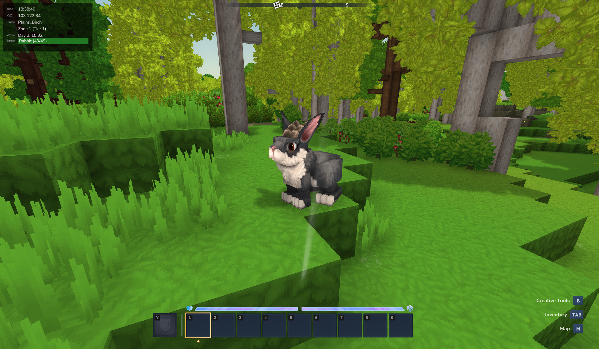
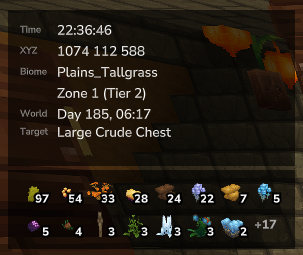
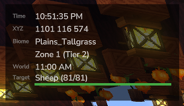
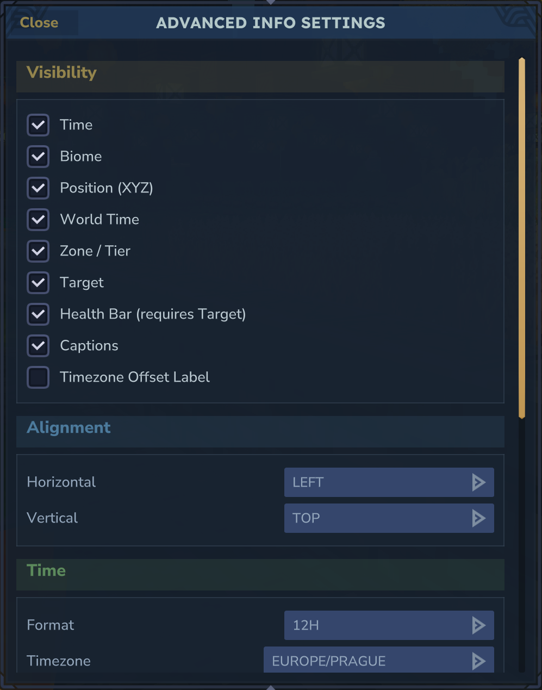
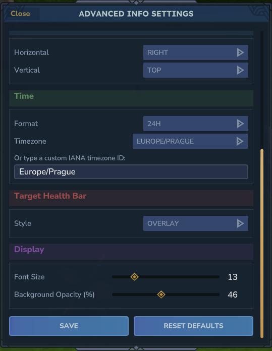
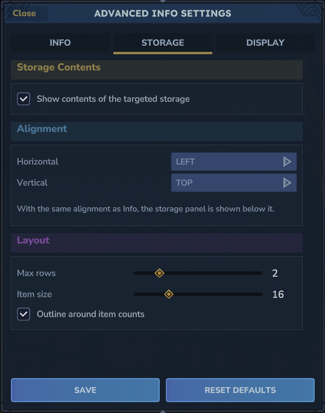
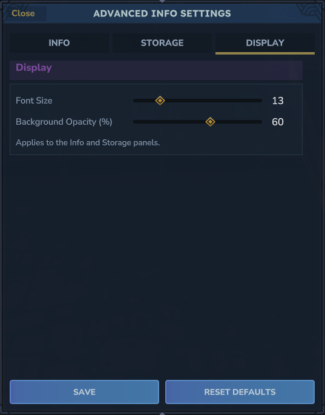

# AdvancedInfo

A Hytale server plugin that displays a configurable information HUD with real-time data about the player's surroundings and current target.

The panel is registered as its own keyed HUD, so it coexists with other mods' custom HUDs.



## HUD Panels

- **Time** - the server's current wall-clock time.
- **Biome** - the name of the biome the player is standing in.
- **Position** - the player's current XYZ coordinates.
- **World Time** - the in-game world time.
- **Zone** - the zone and tier the player is currently in.
- **Target** - the name and health of the entity or block the player is looking at, with an optional health bar.
- **Captions** - labels shown next to each HUD value.
- **Timezone Offset** - the UTC offset of the active timezone shown next to the time (hidden by default; requires a timezone to be set).

## Storage Panel

A second panel that appears while the player looks at a storage block (chest, barrel, …) and lists
its contents: one icon per item type with the total count, sorted from the largest count to the smallest.

- Has its own alignment, independent of the info panel; with the same alignment it is shown below the info panel.
- By default it is shown and placed where the info panel is.
- Uses the width and background opacity of the info panel. The size of the item icons and counts has its own
  setting (`/ai storage size`), which only changes how many items fit in a row.
- The counts have a black outline for readability on light icons; it can be turned off (`/ai storage outline off`).
- The number of item rows is limited (`/ai storage rows`); further items are summarised as `+N`.
- With the SimpleClaims mod installed, the contents of a storage block in a claimed chunk are only shown to
  players who may open it there.



## Target Health Bar

- Two display styles: `below` (bar underneath the name) and `overlay` (name rendered on top of the bar).
- Health-gradient color: transitions from red through orange and yellow to green based on remaining health.
- Can be toggled independently from the target panel.



## Settings UI

Run `/ai ui` to open the in-game settings page. It configures all options without typing commands and is split into tabs:

- **Info** - the info panel:
  - **Visibility** - toggle each HUD panel on or off individually.
  - **Alignment** - choose horizontal (`left`, `center`, `right`) and vertical (`top`, `bottom`) position.
  - **Time** - switch between 12-hour and 24-hour format, select a timezone from a dropdown, or type any IANA timezone ID directly, and choose how the world day is shown (hidden, day of the year, total days).
  - **Target Health Bar** - choose the display style (`overlay` or `below`).
- **Storage** - the storage panel: show or hide it, its alignment, the maximum number of item rows (1-6), the item size (10-32) and the outline around the counts.
- **Display** - sliders for the font size (8-32) and the panel background opacity (0-100 %), shared by both panels.

Use **SAVE** to apply and close, **RESET DEFAULTS** to restore all settings, or **Close** to discard unsaved changes.






## Commands

All commands use `/advanced-info` or the alias `/ai`.

| Command | Description |
|---|---|
| `/ai ui` | Open the in-game settings UI. |
| `/ai show <element>` | Show a specific HUD element. |
| `/ai hide <element>` | Hide a specific HUD element. |
| `/ai show captions` | Show all HUD element captions. |
| `/ai hide captions` | Hide all HUD element captions. |
| `/ai show all` | Show all HUD elements. |
| `/ai hide all` | Hide all HUD elements. |
| `/ai time <12\|24>` | Set the time display format to 12-hour or 24-hour. |
| `/ai day <none\|year\|total>` | Show no day, the day of the in-game year (default) or the total number of days since the world started in the world time row. |
| `/ai timezone <zone>` | Set the timezone for the time display using an IANA zone ID (e.g. `Europe/Prague`, `America/New_York`, `UTC`). |
| `/ai align <h> <v>` | Set both horizontal and vertical alignment at once. |
| `/ai halign <left\|center\|right>` | Set the horizontal alignment of the HUD panel. |
| `/ai valign <top\|bottom>` | Set the vertical alignment of the HUD panel. |
| `/ai healthbar <below\|overlay>` | Set the health bar display style. |
| `/ai font <size>` | Set the font size of the HUD labels (range: 8-32, default: 18). |
| `/ai opacity <percent>` | Set the panel background opacity (range: 0-100, default: 60). |
| `/ai storage align <h> <v>` | Set the horizontal and vertical alignment of the storage panel. |
| `/ai storage rows <n>` | Set the maximum number of item rows in the storage panel (range: 1-6, default: 2). |
| `/ai storage size <n>` | Set the size of the item icons and counts in the storage panel (range: 10-32, default: 18). |
| `/ai storage outline <on\|off>` | Turn the black outline around the item counts in the storage panel on or off (default: on). |
| `/ai status` | Print the current visibility and configuration of all HUD elements. |
| `/ai reset` | Reset all settings to their default values. |

Available elements for `show`/`hide`: `time`, `biome`, `position`, `worldtime`, `zone`, `target`, `healthbar`, `timezone`, `storage`.

## Permissions

Every player can use the mod by default. Server admins can take parts of it away, either for single
players or for a whole group, by adding a deny entry (a permission prefixed with `-`).

| Permission | Grants |
|---|---|
| `advancedinfo.command` | The `/ai` command and all its subcommands. |
| `advancedinfo.command.<subcommand>` | A single subcommand, e.g. `advancedinfo.command.ui` or `advancedinfo.command.show.healthbar`. |
| `advancedinfo.health` | Seeing the target's health (the numbers next to its name and the health bar). Without it, the health options are also hidden from the settings UI. |
| `advancedinfo.storage` | Seeing the contents of the targeted storage block in the storage panel. Without it, the panel, its settings tab and the `/ai storage` settings are unavailable. |

Examples:

- Hide target health from one player: `/perm user add <uuid> -advancedinfo.health`
- Hide target health for all regular players: `/perm group add hytale:Adventurer -advancedinfo.health`
  (groups that inherit from `hytale:Adventurer` are affected too; `hytale:Admin` keeps it through `*`
  unless you add the deny entry there as well)
- Hide storage contents for all regular players: `/perm group add hytale:Adventurer -advancedinfo.storage`
- Disallow the `/ai` command for one player: `/perm user add <uuid> -advancedinfo.command`

The same entries can be written to `permissions.json` directly.

## Settings

All settings are saved per-player and persist across sessions. Settings introduced in future versions are automatically migrated with sensible defaults.

## Building

Requirements: JDK 25 (downloaded automatically by Gradle if missing) and a local Hytale installation.

```sh
./gradlew build
```

The build compiles against `HytaleServer.jar` from the official launcher install. To use a different jar
(for example a standalone dedicated server), set `hytale_server_jar` in `~/.gradle/gradle.properties`
or the `HYTALE_SERVER_JAR` environment variable.

To copy the freshly built jar into a mods folder (a dedicated server's `mods/` or the launcher's
`UserData/Mods` for singleplayer):

```sh
./gradlew deployToServer
```

with `hytale_mods_dir` (or `HYTALE_MODS_DIR`) pointing to that folder.

The jar name and manifest version are derived from `plugin_version` and `release_type` in `gradle.properties`;
see the comments there for details.

`./gradlew curseforgeDescription` renders this README with absolute links into
`build/curseforge/description.md` for the CurseForge project page.

## Changelog

See [CHANGELOG.md](CHANGELOG.md) for the full version history.
